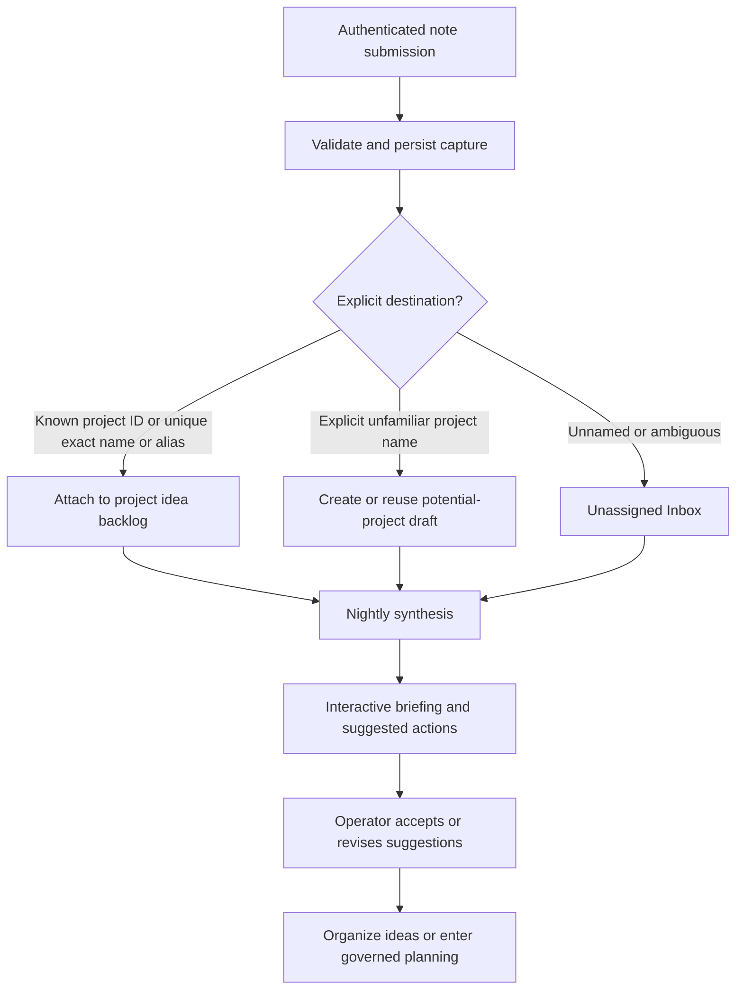

# Surety portfolio and idea intake brief

**Status:** Product direction and design input, 2026-10-16. Sean requested this reference after discussing the portfolio UI, Integrations, idea intake and nightly briefings with Astra. The direction below is agreed for architectural consideration; proposed mechanics and recommendations are not adopted contracts. **This is not implementation authorization, a numbered detailed design, or an addition to an existing milestone.**

**Audience:** The architects designing Surety's operator UI and the capabilities beneath it. Read this before fixing project navigation, intake, notification or cross-project relationships. Existing foundations, errata and adopted contracts retain their authority.

## 1. Product direction

Surety should have a portfolio view above its per-project delivery workflow. The operator selects a project representing an application, sees its intent and delivery state, and can relate it to other applications through **Integrations**. The experience should also support ideas that are not ready to become active projects.

An authenticated inbound API receives the operator's notes and ideas. An explicit existing project can receive its notes automatically. An explicit unfamiliar project name can create a **potential-project draft**. Unnamed or ambiguous material goes into an **Inbox**, the operator's “brain dump.” A nightly process organizes this material into an interactive HTML briefing and delivers it through an operator-configured API or SMTP channel.

The briefing recommends actions such as “create a project called X,” “combine these ideas,” or “attach this note to an existing project.” The operator can accept, edit, defer or dismiss those suggestions. Capturing an idea is deliberately easier than authorizing a specification change or build.

This is a portfolio and intake capability around the delivery engine. It does not establish a second scheduler or an independent approval system.

## 2. The proposed UI structure

| Area | What the operator sees | Meaning |
|---|---|---|
| Projects | An application selector, project overview, specification, architecture, work, environments, decisions and history | Active delivery projects retain their governed lifecycle. |
| Integrations | Connections between applications, their contracts, environments and compatibility evidence | An explicit relationship, not an automatic grant of access. |
| Potential projects | Named drafts, grouped ideas, unanswered questions and proposals for promotion | Candidates for future work; no build or deployment authority. |
| Inbox | Unassigned notes, uncertain matches and material awaiting organization | Durable capture without forcing premature classification. |

The project selector supplies navigation context. It is not, by itself, a security tenant boundary. The design must separately state authorization scope, data visibility and execution isolation; it must not infer multi-user tenancy from the UI metaphor.

Portfolio and project views should distinguish captured material, suggestions, owner decisions, approved intent and observed delivery state. “Added to a project” means attached to its idea backlog, not added to its approved requirements.

## 3. Intake and routing

The proposed intake flow is:

The API shape remains for the detailed design. Its contract should carry the note content, a source event or idempotency identifier, and an optional destination reference. The server supplies trusted receipt time, caller identity and routing provenance; sender-supplied labels must not establish those facts.

Recommended routing rules:

1. A valid, authorized stable project ID takes precedence. A nonexistent or unauthorized explicit ID is refused rather than silently creating or redirecting a project. Conflicting destination references are not guessed away.
2. A unique exact project name or registered alias can route automatically within the caller's authorized scope. Normalization and alias uniqueness need explicit rules.
3. An explicit unfamiliar name creates or reuses a potential-project draft, not an active engine project. Repeated submissions must not create repeated drafts merely because delivery was retried.
4. No destination, an ambiguous name, or a similarity-only match goes to the Inbox with any proposed destinations kept as suggestions. Similarity is not sufficient authority to attach a note automatically.
5. Corrections and later reassignment retain source and routing history. Model summaries do not replace the source note.

“Brain dump folder” describes the operator experience, not a required filesystem layout. The architect should choose the durable representation and explain how it connects to project records. Preserve source content and provenance subject to Surety's redaction and retention rules; this is not a requirement to persist raw secrets indefinitely.

## 4. The nightly briefing

The briefing should answer: **What arrived, what does it appear to mean, where might it belong, and what can I decide next?**

| Section | Example | Available action |
|---|---|---|
| New material | Three notes about booking cancellations | Read their sources; keep separate or group them. |
| Suggested placement | “These notes appear relevant to Fieldwork” | Attach to that project's idea backlog, choose another destination or dismiss. |
| Potential projects | “These five notes suggest an equipment-loan application” | Name or edit a draft, combine it with another, defer or propose promotion. |
| Conflicts and questions | “This requested behavior conflicts with the current approved specification” | Open a question or propose the existing governed spec-change process. |
| Pending decisions | Suggestions deferred in earlier briefings | Revisit, dismiss or leave pending without creating duplicate work. |

Recommendations should link to their supporting notes and explain their placement rationale. The briefing must distinguish an explicit operator instruction from an inference made during synthesis. Accepted placement is not confirmation of every factual claim in the note.

Recommended delivery: an authenticated interactive HTML view, with SMTP carrying a short summary and link, and API delivery carrying the briefing identifier, URL and structured recommendations. Delivery destinations are operator configuration, never addresses or callback URLs taken as instructions from a note. The notification contains no approval capability that can be exercised just by fetching a link.

The briefing is a versioned snapshot. An action identifies the recommendation and the input versions it was based on. Before applying it, the server rechecks current permissions, destination and affected state. A stale briefing must not apply a suggestion to a renamed, merged or otherwise changed target without the appropriate reconciliation.

The detailed design must define local timezone, cutoff, retry and missed-night behavior, input bounds, synthesis budget, and delivery status. A failed summary or SMTP/API delivery preserves captured notes and does not silently duplicate suggestions or their effects. No nightly job, paid invocation or delivery channel is enabled by this brief.

## 5. Integrations between applications

Use **Integrations** for application relationships, distinct from the intake and notification connectors that serve the portfolio UI. Examples include one application's API consumed by another, events exchanged between services, or shared identity. An external system may be an integration endpoint without becoming a Surety-managed project.

An integration should eventually identify:

- Provider and consumer, direction, purpose and responsible owner.
- The interface or contract and its version.
- The participating environments and endpoint bindings.
- Required authentication and the references to scoped credentials, without exposing secret values.
- Compatibility expectations, relevant checks and the versions their evidence covers.
- Observed condition and unresolved or unknown state, separately from declared configuration.

This supports impact questions such as “which consumers may be affected by this API change?” It does not authorize Surety to change those consumers, share their secrets or deploy them together. Cross-project access, change propagation and coordinated releases require explicit design and authority. Merely drawing a connection grants none of them.

Start with declared relationships and inspectable contracts. Automatic contract discovery, compatibility enforcement and coordinated deployment can be added in later increments; the UI must not present a declared link as a verified integration.

## 6. Where governance enters

The architect should preserve these proposed boundaries:

| Action | Intended consequence |
|---|---|
| Capture or deterministically route a note | Persist material in an authorized destination; no specification or execution change. |
| Create a potential-project draft | Create an organizational record; no repository bootstrap, agent run or infrastructure allocation. |
| Accept a suggested attachment or grouping | Record the operator's organizational decision and preserve provenance. |
| Promote a potential project | Enter the existing project/idea workflow at an explicitly defined handoff. Promotion does not approve its specification or architecture. |
| Request work for an existing application | Enter the existing governed specification-change or planning workflow as appropriate. A note cannot directly register stage work. |
| Accept an integration proposal | Record the relationship or initiate a governed contract change; do not confer cross-project execution authority implicitly. |

The new intake endpoint should have capture-scoped authority rather than requiring distribution of the engine's unrestricted operator token. Its exposure—local only, private network or remotely reachable—is a design decision. The design should identify which component authenticates requests, what scopes it permits and how it reaches the engine.

Treat note bodies and model-generated suggestions as data. They cannot grant permissions, choose recipients, execute embedded commands, or bypass engine transitions. Render captured content safely in briefings. If synthesis invokes a model, its execution, context access, cost accounting and limits need an explicit governed path; an unmetered cron script is not the assumed implementation.

## 7. Existing contracts to reconcile

| Source | Relevance to this design |
|---|---|
| [D1 engine core](sdlc-design-D1-engine-core.md), §§6, 10–15, with its [resolution note](sdlc-design-D1-resolution-note.md) and current errata | Durable transitions, attention queue, request boundary, events, accounting, records and the invocation choke point. Use existing machinery where it fits; declare extensions rather than inventing incompatible authority. |
| [D2 backends and isolation](sdlc-design-D2-backends-and-isolation.md), §§1–3 | Model execution, operator/control-plane separation and execution boundaries. Intake exposure or a synthesis worker needs a stated trust boundary. |
| [D6 idea to Alpha](sdlc-design-D6-idea-to-alpha.md), §§2–5 and §8 | Sessions, idea/specification/architecture products, governed changes, planning and adoption. These are the existing downstream workflows for promoted ideas. |
| [D7 Designer](sdlc-design-D7-designer.md), opening scope and §§4, 7–8 | The application Designer and its interface inventory are distinct from designing Surety's own operator UI. Portfolio intake does not silently extend M6. |
| [Foundations errata](../foundations/sdlc-foundations-v1.1-errata-draft.md), E9, E14, and subsequent applicable decisions | Attention-queue direction and the relationship of UI work to the platform. Reconcile new decision kinds and UI scope with the current decisions. |
| [Accepted mockup](../mockup/README.md) | Existing operator screens are consumers of engine state. Portfolio navigation should connect them to the new entry points rather than replacing their semantics without a decision. |

This reference intentionally does not assign table names, route names, model choices, new role names or a milestone number. Those belong in the detailed design and its approval.

## 8. Suggested delivery order

1. **Portfolio navigation and durable intake.** Project selection, potential-project drafts, Inbox, authenticated capture, exact routing, provenance and deduplication. Prove capture and manual organization before adding synthesis.
2. **Bounded synthesis and briefing.** A manual briefing first, then nightly scheduling, operator-configured delivery, stale-action validation and the handoff into governed planning. Prove that failures retain notes and that repeated actions cannot duplicate work.
3. **Governed application Integrations.** Declared provider/consumer contracts first; then version-bound compatibility and change-impact behavior. Cross-project release orchestration remains a separate increment.

Useful acceptance cases for the future plan include duplicate API delivery; two projects with similar names; an unauthorized explicit destination; repeated creation of the same named draft; a malicious note that asks to send secrets; a missed nightly run; delivery failure after a briefing was generated; an action from a stale briefing; promotion retried after interruption; and a declared integration that has no verification evidence. These are design inputs, not allocated acceptance rows.

## 9. Questions for Sean

The architects should return with recommendations and concrete consequences for these decisions before implementation:

1. **Initial tenancy and access.** Start with one trusted operator managing multiple applications, or include distinct users/organizations? Recommendation: one operator initially; explicit project scoping without claiming multi-tenant isolation.
2. **Intake reachability.** Which clients need to submit notes, and from where? Recommendation: a narrowly scoped authenticated intake surface, with no remote exposure of the general engine API.
3. **Draft creation policy.** Is automatic creation for an unfamiliar explicit name always enabled or configurable? Recommendation: enable it for authenticated operator capture, creating only potential-project drafts; ambiguous names stay in the Inbox.
4. **Promotion handoff.** Does promotion create an engine project immediately, or open an owner-guided idea/specification session first? Recommendation: an explicit operator act leading into the existing workflow, with the exact project-creation point defined and retried safely.
5. **Nightly operation and delivery.** What timezone, time, budget and initial delivery channel should apply? Recommendation: prove manual briefing generation first; then enable one configured channel and bounded nightly synthesis. No numeric defaults are decided here.
6. **First Integration scope.** Should the first increment only record declared contracts, or also execute compatibility checks? Recommendation: start with declared contracts and impact visibility, visibly unverified until the corresponding evidence mechanism exists.
